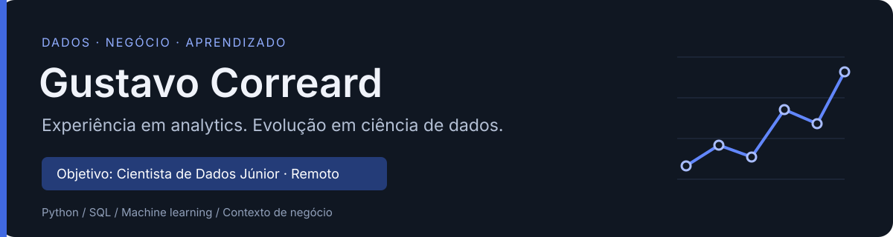
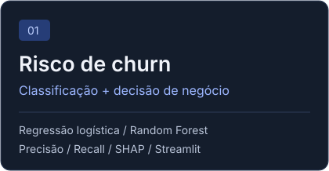
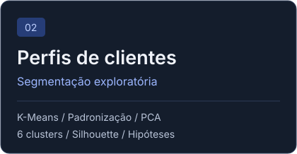
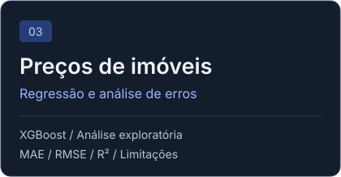

  

  <a href="https://www.linkedin.com/in/gustavo-correard/"><strong>LinkedIn</strong></a>
  &nbsp; · &nbsp;
  <a href="mailto:gustavomacedocorreard@gmail.com"><strong>Contato por e-mail</strong></a>
  &nbsp; · &nbsp;
  <a href="#projetos-selecionados"><strong>Conheça os projetos</strong></a>

## Experiência em dados, próximo passo em ciência de dados

Sou **Analista de Dados**, com mais de quatro anos de experiência em marketplace, varejo e indústria. Busco uma oportunidade **remota de Cientista de Dados Júnior** para contribuir com preparação de dados, análise exploratória e desenvolvimento de modelos.

Minha experiência em analytics me ajuda a conectar o problema técnico à decisão de negócio: entender a demanda, preparar os dados e apresentar resultados de forma útil para o time.

| Experiência | Entrega profissional | Contexto de negócio |
| :--- | :--- | :--- |
| **4+ anos em dados** | **~35h/mês de trabalho manual reduzidas** | **Marketplace, varejo e indústria** |
| OLX, C&A, Nitro Química e BR Media | Automação de pipelines com Python e SQL na OLX | Comercial, marketing e estoque |

## Projetos selecionados

<table>
<tr>
<td width="33%" valign="top">

Identificar clientes com risco de cancelamento e discutir a priorização de contatos.

<a href="https://github.com/Gustavocorreard/churn-ai-agent"><strong>Explorar o projeto de churn ↗</strong></a>
</td>
<td width="33%" valign="top">

Explorar perfis de clientes e formular hipóteses para ações de marketing.

<a href="https://github.com/Gustavocorreard/mall-customers-clustering"><strong>Explorar a segmentação ↗</strong></a>
</td>
<td width="33%" valign="top">

Estimar preços de imóveis e interpretar os erros e limites da avaliação.

<a href="https://github.com/Gustavocorreard/house-price-xgboost"><strong>Explorar a regressão ↗</strong></a>
</td>
</tr>
</table>

Cada repositório documenta **método, resultados registrados, execução e limitações**. São estudos de portfólio; impacto comercial não foi medido.

## Ferramentas que fazem parte do meu trabalho e estudos

| Análise e preparação | Machine learning nos projetos | Comunicação e desenvolvimento |
| :--- | :--- | :--- |
| Python · SQL · pandas · NumPy | scikit-learn · XGBoost · K-Means · SHAP | Power BI · Tableau · Looker Studio |
| Trino · Teradata · BigQuery/GCP | Experiência com previsão de leads usando Prophet | Git · Jupyter · Streamlit |

## O que estou aprofundando

**Estatística aplicada → validação de modelos → experimentação → operação de modelos**

Meu foco atual está em probabilidade, amostragem, testes de hipóteses e avaliação sem vazamento de dados. Aplico os estudos na evolução dos projetos e uso LLMs como apoio para estudar e revisar código, verificando as decisões e os resultados na execução.

**Formação:** Engenharia de Produção pelo UNISAL e pós-graduação em Ciência de Dados e Inteligência Artificial em andamento na Universidade São Judas Tadeu.

---

  <strong>Vamos conversar sobre uma oportunidade de Cientista de Dados Júnior?</strong> 
  Interesse em times remotos de marketplaces, varejo, CRM e analytics comercial.  
  <a href="https://www.linkedin.com/in/gustavo-correard/">LinkedIn</a> &nbsp; · &nbsp;
  <a href="mailto:gustavomacedocorreard@gmail.com">gustavomacedocorreard@gmail.com</a>

